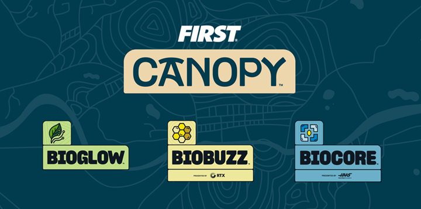

<!-- Generated by ftc_manual_dump.py from the official BIOBUZZ Competition Manual HTML, version TU09 (Nov 12, 2026). Do not edit by hand. The PDF outranks this copy. -->

# 2 *FIRST* Season Overview

**Engineer a Thriving Planet with *FIRST***

Nothing on Earth thrives alone. Every gene, species, and ecosystem is part of a rich web of biological diversity that powers clean air, fresh water, and food. With STEM as their tool and nature as inspiration, today’s boldest innovators are finding new ways to strengthen the connections that protect our shared home.

Building. Problem solving. Growing stronger through teamwork.

Welcome to *FIRST*® CANOPY™, our 2026-2027 robotics season inspired by nature.

**LEARN MORE:** <https://www.firstinspires.org/first-canopy>
